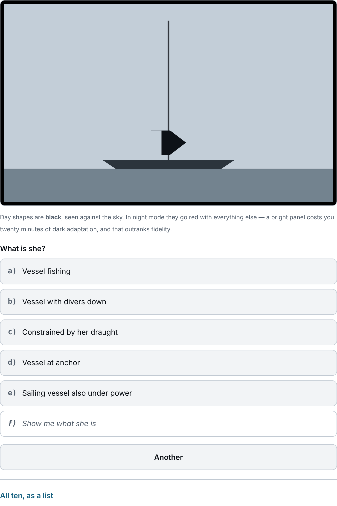

# COLREGS
## What she is, what she is doing, and who gives way

**Version {{VERSION}}** — a training aid for the International Regulations for
Preventing Collisions at Sea, offline, on a phone, a tablet or a terminal.

---

## 1. What this is, and why it is built this way

COLREGS teaches the four things a watch leader has to produce in the dark,
from what is in front of him:

1. **What she is** — from her lights at night, or her day shapes by day.
2. **What she is saying** — from her sound signals.
3. **Who gives way** — and what the action actually is.
4. **Where she is going** — from bearing drift, which is the one observation
   that answers it without a plot.

Four constraints shaped it, and each has a consequence worth knowing.

**1. It has to work with the antenna down.**
Consequence: everything ships with the program. There is no lookup, no
account and no year in which it stops working. The browser build caches
itself on first visit and then needs nothing.

**2. It has to be usable at night without spoiling your night vision.**
Consequence: a night mode in which every lamp goes red and the letters
**W R G Y** beside each lamp carry the pattern. A dark-adapted eye costs
about twenty minutes to recover from a bright panel, and that outranks
fidelity of colour.

**3. It has to ask the question the way the sea asks it.**
Consequence: nothing has a "show me the answer" button alone. Recognising a
correct answer when it is put in front of you is far easier than producing
one, and producing one is the job. Every view asks first and tells afterwards.

**4. The content must not be a retyped copy of anything.**
Consequence: the browser build's data was produced by running the shell
engine's own tables and printing what they built — twenty-eight vessels, ten
day shapes, twenty-eight encounters, fifteen sound signals, fifteen lessons.
The two builds cannot drift, because one is generated from the other.

---

## 2. The two builds

The same content, in two places, because they are used at different moments.

| | the browser app | the shell tool |
|---|---|---|
| Where | `bashnav.navigationtools.org/web/colregs/` | `colregs` at a prompt |
| Lights, day shapes, sound signals | yes, drawn and sounded | yes, drawn in characters |
| Encounters | yes | yes |
| The fifteen rule lessons | yes | yes |
| Contact management | yes | yes |
| The collision-avoidance scenario | **no** — shell only | yes |
| Sound you can hear | **yes** | no: a terminal draws a blast |
| Reference tables, the card | by list in each view | `colregs ref`, `colregs card` |

**The browser build is the one to have on deck.** Add it to the home screen
and it opens like an app, works with no signal, and draws the lamps as lamps.

**The shell tool is the one with the scenario** — the developing situation
with a radar plot, three timed observations, the vector triangle and a CPA.
It is the largest single piece in the program and it has not been rebuilt for
the browser yet.

---

## 3. Lights

A vessel is drawn from the bearing **you** are on, and you can move that
bearing and watch her lights open and close.

**What the drawing is telling you, and what it is not.**

1. **The lamps are where the rules put them** — the vertical order and the
   sectors are from the Convention, drawn rather than described.
2. **Sideways spacing is where a lamp sits along the hull,** not a heading
   cue. At any real range the lamps of one vessel are in line; the spread in
   the drawing exists so you can see which lamp is which.
3. **The sidelight cut-off is ±2.5°, not exact.** Annex I allows the cut-off
   to fall up to 3° outside the prescribed sector, so there is a small arc
   right ahead where **both** sidelights are seen. The drawing shows that,
   because a drawing that claimed a clean cut-off would teach you to call
   dead-ahead when you are not.
4. **Every lamp carries its letter** — W white, R red, G green, Y yellow. The
   pattern has to read with no colour at all, because in night mode it has
   none, and because colour is the first thing a tired eye gets wrong.
5. **A lamp marked `fl` flashes.** Annex I puts that at 120 or more flashes a
   minute, and the rate is part of the identification.

**Deck lights.** The **Deck lights off / on** button lights her working decks.
Rule 20(b) allows working lights so far as they cannot be mistaken for the
prescribed lights; a vessel at anchor may light her decks, and one of 100 m or
more must (Rule 30(c)). Turn them on and see why a trawler working with her
decks blazing is so much harder to read than the diagram suggests.

**The four wrong answers are chosen to be confusable with the right one.**
Each candidate is scored on how much of its signature it shares with the
answer — lamp colours for lights, the glyph stack for shapes, the sequence of
blast kinds for sounds — and the closest four are offered, with a little noise
so the same question is not always the same five rows. Over the whole data
set the candidates offered share 3.79 lamp colours with the answer against
2.74 for random picks. **A trawler is set against a mine clearance vessel and
a pilot vessel on duty, not against a seaplane.**

A wrong tap marks that row and leaves the others live, so a miss costs you
another look at the picture rather than ending the question.

---

## 4. Day shapes

The same meanings by daylight: ten of them, from the single black ball of a
vessel at anchor to the ball-diamond-ball of a vessel restricted in her
ability to manoeuvre.

**One deliberate inversion.** Day shapes are black. Drawing them white on a
night sky would be backwards, so in dark mode this one view gets a daylight
sky and black shapes. **In night mode it stays red on black** — fidelity loses
to dark adaptation, as it should.

---

## 5. Sound signals

Fifteen signals, with the rule each comes from and the circumstances it is
made in. The browser build makes the sound: short blasts, prolonged blasts and
the bell, synthesised at their real durations.

**A prolonged blast is supposed to feel long.** The shell tool's engine says,
in a comment, that a script cannot make a noise so it draws one. A browser can,
and the difference matters: the distinction between one short blast and one
prolonged blast is a distinction in duration, and reading it off a page teaches
you the wrong thing.

The question is the same shape as the others — what is she saying, five
candidates, one row that gives up.

---

## 6. Encounters

Twenty-eight situations: what you are, what you see, and where she is.

The plot is **head-up**: your own head is up the page, she is drawn where she
bears and heading as she heads. Four answers are offered, and they are not
"stand on / give way" alone — each names the **action**, because the rules
require an action and not a category:

> *Give way: alter to starboard and pass down her port side.*

The wrong answers are the plausible ones: altering to port in a crossing
situation, standing on when you are the give-way vessel, assuming a restricted
vessel will keep clear of you when she cannot.

**Right and wrong carry a tick or a cross,** not only a green or red border.
In night mode every colour token collapses to red, so a border alone would
make the two states identical exactly where it matters most.

---

## 7. The fifteen rule lessons

Each lesson is a short passage, a question and the reason behind the answer.
Progress is kept, so you can do one at a time.

| | |
|---|---|
| L1 | Rule 5 — Look-out |
| L2 | Rule 6 — Safe speed |
| L3 | Rule 7 — Risk of collision |
| L4 | Rule 8 — Action to avoid collision |
| L5 | Rule 9 — Narrow channels |
| L6 | Rule 10 — Traffic separation schemes |
| L7 | Rule 12 — Sailing vessels |
| L8 | Rule 13 — Overtaking |
| L9 | Rule 14 — Head-on situation |
| L10 | Rules 15 and 16 — Crossing, and the give-way vessel |
| L11 | Rule 17 — Action by the stand-on vessel |
| L12 | Rule 18 — Responsibilities between vessels |
| L13 | Rule 19 — Restricted visibility |
| L14 | Rules 20 to 31 — Lights and shapes |
| L15 | Rules 32 to 37 — Sound and light signals |

In the shell tool, `colregs lesson L7` opens one directly, and
`colregs numbers` drills which rule is which, both ways round.

---

## 8. Contact management

The section a tracking party would recognise: what a contact's **bearing
drift** tells you, how to say it, and the arithmetic you do in your head.

| | |
|---|---|
| C1 | Relative motion — the only plot that answers the question |
| C2 | Drift toward the bow, and drift away from it |
| C3 | Constant bearing, decreasing range |
| C4 | The report |
| C5 | The arithmetic you do in your head |
| C6 | Ekelund — range out of a course change |
| C7 | Relative bearings — so he can find her |

### The rule the section is built on

> **Drifting away from your bow, she passes astern or never crosses your track
> at all. Drifting toward your bow, she crosses ahead — or draws ahead and
> clears.**

**It is not a rule of thumb.** Relative motion is a straight line, so the
bearing sweeps one way and can never reverse: a contact drawing away from the
bow cannot come back to it. It was checked over 700,000 random geometries —
own speed 4 to 25 knots, any contact course and speed, range 2 to 15 miles —
with no exception in either sector.

**The asymmetry is why it is worth saying out loud.** Drifting away, the miss
is behind you and growing. Drifting toward, the miss is being built ahead of
your bow, and it shrinks to zero as the drift rate does.

### Where good drift is still not safe

Rule 7(d)(i) is the constant-bearing case everyone knows. Rule 7(d)(ii) is the
one that catches people, and C3 covers three of them:

1. **A very large vessel.** You plotted her bridge. Her bow is a ship's length
   nearer, and it is the bow that arrives.
2. **A tow.** The tug clears. The barge on the wire behind her does not.
3. **Close range.** Drift goes as the square of the range, so at close quarters
   a safe-looking drift is a small miss.

### The report

Designation, bearing, drift, range, CPA, time — **bearing before drift**, and
**"steady" said out loud** rather than left as a silence that could mean you
have not looked.

### The arithmetic

The three-minute rule, the six-minute rule, time to CPA, and one degree at one
mile ≈ 35 yards for estimating the miss.

### Ekelund ranging — range from a change of course

Derived rather than quoted. The target's speed across the line of sight is
unchanged between the two legs, so all of the change in bearing rate belongs
to own ship:

    R(kyd) = 1.91 × ΔS⊥(kt) / Δω(°/min)        S⊥ = own speed × sin(course − bearing)

Checked against the true range over 59,000 geometries to 8×10⁻¹⁴ relative
error, and over 300 generated leg pairs the worst recovery is 5.9% — which is
bearing-rate rounding to a tenth of a degree a minute, not the formula.

### The two exercises

**`track` — the tracking watch.** Own course and speed, night orders of 3,000
yards, five marks three minutes apart. Three questions: the drift, where she
goes, the CPA band. **One run in five is a genuine collision.** The reveal
draws the relative-motion plot head-up with the CPA marked, and gives the
report you would have made.

**`ekelund`.** Two legs with their bearing rates; name the range band. The
reveal shows the working.

---

## 9. The collision-avoidance scenario (shell only)

`colregs scenario` runs a situation as it develops: the radar plot, three
timed observations, the vector triangle, the CPA, and then the true-motion
animation of what actually happened — including what happens if you do
nothing. At the lights prompt, `y` shows what **each** boat sees of the other,
which is the part that explains why she is not altering.

It is the one section that is not in the browser build. Everything it needs is
in the shell tool today; nothing in the browser build depends on it.

---

## 10. Reference, and how a bearing is spoken

**Reference tables** — `colregs ref`: all the lights as a list, all the day
shapes, and the sound-signal table. In the browser, each view has the same
list folded away at the foot of it.

**The contacts card** — `colregs card`: the whole of section 8 on one screen,
to read before a watch.

**Reporting style** — `colregs style <name>`, or `s` from the menu. It changes
how a relative bearing is *said*; the true bearing is always given as well,
because that is what goes on the chart and what agrees with the radar.

| | | |
|---|---|---|
| `rn` | Red and Green | *"bearing 311, Red 20, drawing left"* — Royal Navy and British practice. The side is carried by a **word**, which survives a bad intercom, a following sea and a tired listener. |
| `usn` | Port and starboard | The same information in plainer words; common in US and merchant practice. Longest to say, hardest to misunderstand. |
| `rel360` | Relative, full circle | *"340 relative"* — neat on a plot, worse in the dark: the listener has to work out which side 340 is on, which is the sum you were trying to save him. |
| `words` | Words only | *"fine on the port bow"* — slowest to say, fastest to act on. |
| `none` | True bearing alone | |

---

## 11. The display modes

{{INCLUDE:common-display-modes.md}}

---

## 12. Offline, and putting it on the home screen

The browser build caches itself on the first visit — cache-first, because
nothing in it changes while you are offshore and a lookup you cannot satisfy
is only latency.

1. Open it once with a signal.
2. **Share → Add to Home Screen.**
3. Open it from the icon. It runs with the antenna down, full screen, with no
   browser furniture.

Opened straight from a file it also works — the content is in a script rather
than fetched — but there is no cache to install and no icon.

The foot of the home screen says what it actually holds, so you can see
whether it is installed before you need it to be.

---

## 13. Where the content comes from

1. **The rules are the IMO's.** The Convention is what governs at sea. This
   program paraphrases to teach; where the two differ, the Convention is
   right.
2. **The browser build's data is generated from the shell engine**, by running
   its own table initialisers and dumping what they built. It is never
   hand-edited: it is regenerated, so the two builds cannot drift.
3. **The geometry is ported function for function** — the visibility arc, the
   bearing normalisations, the projection, the hull half-width — with the same
   names, so the awk and the JavaScript can be read side by side. Both are
   then run over all 361 integer bearings and the output compared. It is
   identical.
4. **That check earned its keep immediately.** The first port used a sidelight
   cut-off from an older copy of the engine. The diff caught it on four
   bearings — the four where the difference shows.

---

## 14. Cautions

1. **This is a training aid, not the Convention.** The rules are published by
   the IMO and are what govern at sea. Where this program and the Convention
   differ, the Convention is right and this is wrong.
2. **A lesson is not a licence.** Nothing here replaces a qualified course, a
   proper look-out, or the judgement Rule 2 requires of you.
3. **The drawings are schematic.** Real lights are dimmer, further apart in
   range than in angle, and often obscured by deck lighting, haze, shore
   lights and the motion of your own boat.
4. **Bearing drift is an observation, not a prediction.** It tells you what is
   happening now. It assumes both vessels hold course and speed, and the
   moment either alters, you start again.
5. **In restricted visibility you do not have a stand-on vessel.** Rule 19 is a
   different rule from Rule 15, and the lessons keep them apart.
