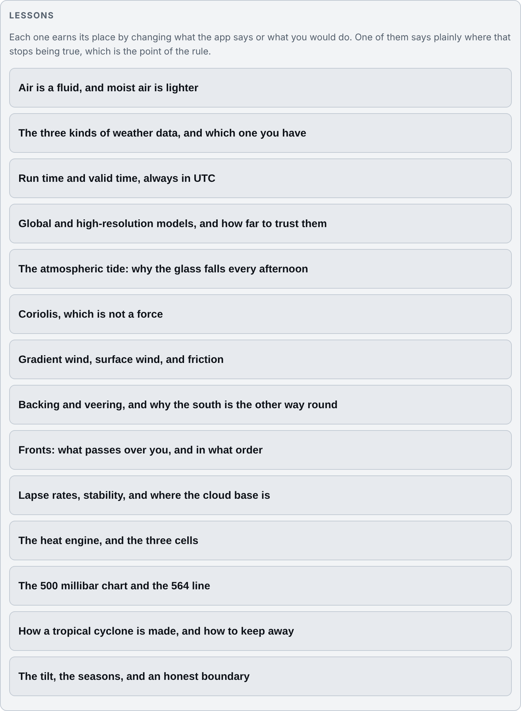

# WEATHER
## Read your own barometer

**Version {{VERSION}}** — reasoning from the observations you took, with no
network at all. It cannot forecast for you. It can make you a forecaster.

---

## 1. The honest limit, first

**With no network this cannot forecast.** No GRIBs, no synoptic charts, no
models, and there never will be any: there is no connection here to make one
with.

What it does instead is reason from the **observation** column — ground truth
you measured with your own instruments — which is the one category of weather
data that is never wrong, and the one still available when the antenna comes
down.

> Celestial navigation is what you do when the GPS dies.
> This is what you do when the sat comms die.

Everything below follows from that.

---

## 2. Where its numbers come from

It reads the log that `deck-log` writes — the same records, in the same store,
on the same device. Nothing is copied between the two tools and there is
nothing to keep in step.

**So the quality of what this tool says is the quality of your observations.**
Pressure to a tenth of a millibar, the cloud by level, the dew point, and the
swell period are what the reasoning actually uses. A log of position and
course alone gives it almost nothing to work with.

---

## 3. What the log says

`weather what` (or **What the log says**) takes your last observations and
reasons out loud. Every line is followed by the rule it came from, in smaller
type, because the point is that you can do this yourself afterwards.

### The glass

The screen opens with a barograph drawn from your own log (Figure 1): every
pressure of the last 24, 48 or 72 hours, ending at the latest. Three buttons
choose the window, and the choice is remembered.

1. **The trace is your readings,** joined in order. Each stretch is drawn in
   the colour *and* the weight of its tendency, so it reads in the night
   display too, where every colour is a red: thin for steady, heavier for
   rising, heavier again for falling, heaviest for falling fast.
2. **The strip beneath says the same in words,** with neighbouring stretches
   of the same tendency joined: *steady, falling, falling fast, steady, rising*
   is a depression going through.
3. **The grey wave behind is the daily tide alone,** drawn from your first
   reading: what the glass would do in settled weather. A trace that follows
   the wave is only the tide. A trace that leaves it is weather. In the trade
   winds the wave is 1.3 hPa each way and is most of what the barometer does;
   in the Channel it is a ripple of 0.4.
4. **The key is drawn to scale.** Each key line has its own slope on these
   axes: the line for *falling* drops 1.5 hPa in 3 hours as measured against
   the scales beside it.

In the terminal the same thing is a short table, one line for each run of the
same tendency: `weather what` for 48 hours, `weather what 24` or `72` for the
others.

The wave needs your longitude, for the local sun time, and a latitude, which it
takes from the log. Without one of them the trace is drawn without the wave,
and the figure says which is missing.

### The pressure

**The rate matters more than the level.** 1000 hPa steady is a quiet day;
1015 falling fast is not. The wording follows the three-hour change:

| | |
|---|---|
| 3.0 hPa or more of fall in 3 h | *a serious fall — expect a deepening system and a rising wind* |
| 1.5 to 3.0 | *a definite fall. Something is coming* |
| within 1.5 either way | *near steady* |
| 1.5 or more of rise | *rising — the gradient is easing or a ridge is building* |

**It corrects for the atmospheric tide first.** The atmosphere has its own
semidiurnal pressure wave, largest in the tropics, and near the equator it is
big enough to hide a real trend or invent one. The correction needs your
longitude, which is why `weather lon <deg>` exists, and your latitude, which
comes from the log. Only a deck entry carries a position, so a weather
observation logged on its own takes the position of the last deck entry before
it. With no position anywhere in the log the tide is not allowed for, and the
report says so.

### The wind

**Backed or veered**, against the previous observation, with Buys Ballot
applied: stand with your back to the wind and in the northern hemisphere the
low is on your left. The tool gives the bearing of the centre from you.

**Backing with a falling glass is the one to take seriously** — it puts the
centre to your north and closing.

### Fog, and the cloud base

1. **Fog**: the margin between dew point and sea temperature. When the air's
   dew point is at or above the sea temperature, you are in the business of
   making fog.
2. **Cloud base**: the spread between temperature and dew point closes at
   about 2.5 °C per 1000 ft — a parcel cools at 3 and its dew point falls at
   0.5, and the *difference* is what counts. Using the lapse rate alone puts
   the base about a fifth too low.

### The cloud sequence

The classic warm front is cirrus, then cirrostratus, then altostratus, then
nimbostratus and rain. The tool watches your `ch` / `cm` / `cl` codes over
successive observations and tells you how far through that sequence you are —
which is a judgement you cannot make from a single observation, and the reason
the cloud is logged by level rather than as "overcast".

---

## 4. The forecast loop, and why yours comes first

**Nothing of the machine's appears until your own forecast is recorded.** If
the app prints its guess first, you have not forecast anything: you have
agreed with something. The loop is deliberate:

1. You write your forecast — wind direction and speed, pressure, and the
   weather.
2. Only then does the tool show its own two: the **rules** forecaster, and
   **persistence** (tomorrow is like today).
3. When the verifying observation arrives, all three are scored against it.

**Persistence is in there because it is the honest benchmark.** It is
surprisingly hard to beat over 12 hours, and a forecaster who cannot beat it is
not yet adding anything.

---

## 5. The score

Weighted error points, from the WxChallenge convention: half a point per knot
of wind speed, one per millibar, a tenth per degree of wind direction — so a
near miss costs little and a bad miss costs a lot.

The score exists to answer one question honestly: **are you getting better, and
are you better than persistence?**

---

## 6. The 500 millibar chart

**This tool cannot fetch a chart and never will.** But a 500 mb chart does
arrive at sea, by HF radiofax on an SSB receiver, with no internet involved at
all — and it is the one upper-air product worth having, because the 500 mb flow
is what steers the surface systems.

So `weather chart` asks for what you can read off the fax with a ruler, and
the rules do the rest, showing every step:

| | |
|---|---|
| Bearing to the **564 line** | the 5,640 m contour: the storm track runs along it |
| Its distance, in miles | |
| The line's orientation | which way it lies across your position |
| The 500 mb wind there, in knots | how fast the pattern is being steered |
| Hemisphere | which side of the line is the poleward one |

The first question it answers is whether the 564 line is **poleward of you**,
because equatorward of it is where you want to be. The rules are from
Sienkiewicz and Chesneau, *Mariner's Guide to the 500-Millibar Chart* (NOAA,
public domain), and are listed in `docs/SOURCES.md`.

---

## 7. The wind from the isobars

The second chart a navigator reads is the surface chart, and the wind on it is
in the isobars. Measure the gap between two neighbouring isobars where you are,
in nautical miles: on a paper chart, that is minutes of latitude on its side
scale. Give the screen that gap, your latitude and the isobar interval (4 hPa on
most charts), and it works the rest:

1. **The wind aloft**, along the isobars. The closer they are, the harder the
   push toward the low and the stronger the wind; the earth's turn bends it until
   the bend matches the push. At 100 nm apart and 50° N that is 31 knots.
2. **Nearer the equator the same spacing blows harder,** because the earth's
   turn is weaker there: 100 nm at 30° N is 47 knots. Within 5° of the equator
   the balance does not hold at all, and the screen says so rather than give a
   number.
3. **The wind on deck,** from the friction rules of the `gradient` lesson: about
   two thirds over the sea, turned 10 to 20 degrees toward the low (backed in the
   north, veered in the south); a third to two thirds over land.
4. **Straight isobars only.** Round a tight low the wind is less than this and
   round a high more; the Coriolis lesson's wind panel shows by how much.

The same scale is printed in the `gradient` lesson, so it is met twice. In the
terminal it is `weather isobars`, with the questions asked in turn, or the
answers given at once: `weather isobars 100 50 N 4`. A lesson of the course can
open the screen with its own example filled in, and then shows **Back to the
lesson** at the top.

---

## 8. The lessons

Each lesson changes either what the tool says or what you would do. One of them
says plainly where the reasoning stops being reliable, which is the most
important of the eleven.

`weather learn` lists them; `weather learn <key>` opens one.

Some lessons draw what they say. The `gradient` lesson draws friction (Figure
6), the turn toward the low and the loss of speed, as a figure in the terminal
and in the browser. The land speed is drawn as a band, not one number, because
the published rules of thumb disagree, from 1/3 (the Royal Meteorological
Society) to 2/3 (US Navy training), and because the ground decides it: trees
and buildings drag the wind more than open fields do. Figure 8 is the
northern hemisphere's; south of the equator the turn is the other way.

The same lesson then shows **why** the wind turns (Figure 9), in a sailor's
terms rather than as equations. Three things act on the wind near the surface:
the push from high pressure toward low, which is what the isobars show; the
earth turning beneath, which bends moving air to its right in the north; and
the drag of the sea or the land. Aloft there is no drag, so the bend grows until
it matches the push and the wind runs along the isobars. Near the surface the
drag slows the wind, a slower wind is bent less, and the push toward the low
wins a little. In the browser a slider runs the drag from none to forests and
towns, and a few sentences under it say what is happening at each stage. The
triangle describes the lowest kilometre or so of air; on deck the wind is slower
again, which is why the rule of thumb over the sea is about two thirds.

**Backing and veering** have a lesson of their own, `weather learn veer`,
because the words do two jobs. Over time (Figure 10) they say which way the wind
has shifted, and the "What the log says" screen uses them in that sense. Against
the wind aloft (Figure 11) they describe the friction turn, which is backed in
the north and veered in the south. The lesson also says what a shift tells you:
in the Channel, a depression passing to the north veers the wind from south-west
through west to north-west as its fronts go through, and the same low south of
the equator backs it instead. The short form is repeated in the Coriolis and
gradient lessons, so it is met more than once.

---

## 9. Commands

| | |
|---|---|
| `weather` | the menu |
| `weather what [24\|48\|72]` | what your log says is coming, with the reasoning, and the glass over that many hours |
| `weather learn [key]` | a lesson; no key lists them |
| `weather chart` | reason over a 500 mb radiofax chart |
| `weather isobars [nm lat [N|S] [hPa]]` | the wind from a surface chart: aloft and on deck |
| `weather forecast` | yours first, then mine, then both are scored |
| `weather score` | how you, the rules and persistence are doing |
| `weather lon <deg>` | your longitude, east positive — for the pressure tide |
| `weather day` / `night` / `plain` | colour mode |
| `weather about` / `version` | |

It reads the deck log; `deck-log` is what writes it. It never forecasts from a
model, because there is no network here and never will be.

---

## 10. The display modes

{{INCLUDE:common-display-modes.md}}

---

## 11. Cautions

1. **This is not a forecast service.** It reasons from what you logged. It has
   no model, no satellite and no warning of anything over the horizon that has
   not announced itself in your own observations.
2. **It cannot see a system that is not yet showing.** A squall line fifty
   miles away affects nothing you have measured until it does.
3. **Garbage in.** An instrument that is out, a pressure read to the nearest
   millibar, or cloud logged as "cloudy" will give confident reasoning from bad
   input. The tool says what it is reasoning from; check that first when an
   answer surprises you.
4. **Near the equator, log your longitude.** Without it the atmospheric tide
   correction cannot be made, and the semidiurnal wave there is large enough to
   look like a trend.
5. **Where this and an official forecast differ, take the official one** and
   treat the difference as something to understand rather than to argue with.
