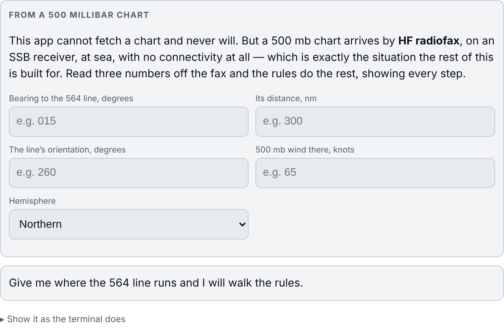

# WEATHER
## Read your own barometer

**Version {{VERSION}}** — reasoning from the observations you took, with no
network at all. It cannot forecast for you. It can make you a forecaster.

---

## 1. The honest limit, first

**With no network this cannot forecast.** No GRIBs, no synoptic charts, no
models, and there never will be any: there is no connection here to make one
with.

What it does instead is reason from the **observation** column — ground truth
you measured with your own instruments — which is the one category of weather
data that is never wrong, and the one still available when the antenna comes
down.

> Celestial navigation is what you do when the GPS dies.
> This is what you do when the sat comms die.

Everything below follows from that.

---

## 2. Where its numbers come from

It reads the log that `deck-log` writes — the same records, in the same store,
on the same device. Nothing is copied between the two tools and there is
nothing to keep in step.

**So the quality of what this tool says is the quality of your observations.**
Pressure to a tenth of a millibar, the cloud by level, the dew point, and the
swell period are what the reasoning actually uses. A log of position and
course alone gives it almost nothing to work with.

---

## 3. What the log says

`weather what` (or **What the log says**) takes your last observations and
reasons out loud. Every line is followed by the rule it came from, in smaller
type, because the point is that you can do this yourself afterwards.

### The glass

The screen opens with a barograph drawn from your own log (Figure 1): every
pressure of the last 24, 48 or 72 hours, ending at the latest. Three buttons
choose the window, and the choice is remembered.

1. **The trace is your readings,** joined in order. Each stretch is drawn in
   the colour *and* the weight of its tendency, so it reads in the night
   display too, where every colour is a red: thin for steady, heavier for
   rising, heavier again for falling, heaviest for falling fast.
2. **The strip beneath says the same in words,** with neighbouring stretches
   of the same tendency joined: *steady, falling, falling fast, steady, rising*
   is a depression going through.
3. **The grey wave behind is the daily tide alone,** drawn from your first
   reading: what the glass would do in settled weather. A trace that follows
   the wave is only the tide. A trace that leaves it is weather. In the trade
   winds the wave is 1.3 hPa each way and is most of what the barometer does;
   in the Channel it is a ripple of 0.4.
4. **The key is drawn to scale.** Each key line has its own slope on these
   axes: the line for *falling* drops 1.6 hPa in 3 hours as measured against
   the scales beside it.

In the terminal the same thing is a short table, one line for each run of the
same tendency: `weather what` for 48 hours, `weather what 24` or `72` for the
others.

The wave needs your longitude, for the local sun time, and a latitude, which it
takes from the log. Without one of them the trace is drawn without the wave,
and the figure says which is missing.

### The pressure

**The rate matters more than the level.** 1000 hPa steady is a quiet day;
1015 falling fast is not. The wording follows the three-hour change:

| | |
|---|---|
| 3.6 hPa or more of fall in 3 h | *a serious fall — expect a deepening system and a rising wind* |
| 1.6 to 3.5 | *a definite fall. Something is coming* |
| less than 1.6 either way | *near steady* |
| 1.6 or more of rise | *rising — the gradient is easing or a ridge is building* |

**These are the Met Office's bands.** Its marine forecasts glossary grades the
three-hour change as *slowly* (0.1 to 1.5 hPa), plain *rising* or *falling*
(1.6 to 3.5), *quickly* (3.6 to 6.0) and *very rapidly* (more than 6.0). Here
*near steady* is their *slowly* and less, and a *serious fall* is their
*quickly* and more. The WeatherGlass and CelestialGlass watch faces use the same
numbers, so the watch and `weather` read the same log the same way.

**It corrects for the atmospheric tide first.** The atmosphere has its own
semidiurnal pressure wave, largest in the tropics, and near the equator it is
big enough to hide a real trend or invent one. The correction needs your
longitude, which is why `weather lon <deg>` exists, and your latitude, which
comes from the log. Only a deck entry carries a position, so a weather
observation logged on its own takes the position of the last deck entry before
it. With no position anywhere in the log the tide is not allowed for, and the
report says so.

### The wind, and where the low lies

**Backed or veered**, against the previous observation. A shift of more than
10 degrees is read by the side of the storm's track, and the reading is the
same in both hemispheres:

1. **If the wind goes on backing, you are on the left of the storm's track,**
   looking the way it is going. It passes south of you if it is going east,
   north of you if it is going west.
2. **If it goes on veering, you are on the right.** It passes north of you if
   it is going east, south of you if it is going west.

**Where the low lies** is Buys Ballot: stand with your back to the wind, and in
the northern hemisphere the low is on your left, in the southern on your right.
The sea turns the wind on deck 10 to 20 degrees in toward the low, so the low
lies up to 20 degrees forward of that arm. The report gives the two bearings.
The compass card (Figure 3) draws them as a wedge, with the low itself out
along it and its wind round it: anticlockwise in the north, clockwise in the
south. How far off the low is, the log cannot say.

**Where it is going.** One boat's log cannot give a storm's course. With a wind
that has shifted more than 10 degrees *and* a glass that is falling or rising,
it can give the quarter of the compass the course lies in. Take the bearing
from the low to you:

| The wind has | The glass is | So | Its course lies |
|---|---|---|---|
| backed | falling | you are on its left, and it is closing | within a quarter turn clockwise of that bearing |
| backed | rising | you are on its left, and it is opening | a quarter to a half turn clockwise of it |
| veered | falling | you are on its right, and it is closing | within a quarter turn anticlockwise of it |
| veered | rising | you are on its right, and it is opening | a quarter to a half turn anticlockwise of it |

The card draws the quarter as a dashed fan from the low. When the low is
closing, the report says where it passes if it holds its course: *its course is
somewhere between 090 and 180; if it holds that, it passes to your south-west.*
When it is opening, the report says it is drawing away.

**These are two rules of thumb.** A low can deepen without moving, or fill
where it lies, and the picture is of a straight track and a boat that is slow
against the storm. It is where to watch, not a fix. Without both a shift and a
moving glass, the card says the course cannot be told yet.

### Fog, and the cloud base

1. **Fog**: the margin between dew point and sea temperature. When the air's
   dew point is at or above the sea temperature, you are in the business of
   making fog.
2. **Cloud base**: the spread between temperature and dew point closes at
   about 2.5 °C per 1000 ft — a parcel cools at 3 and its dew point falls at
   0.5, and the *difference* is what counts. Using the lapse rate alone puts
   the base about a sixth too low.

### The cloud sequence

The classic warm front is cirrus, then cirrostratus, then altostratus, then
nimbostratus and rain. The tool watches your `ch` / `cm` / `cl` codes over
successive observations and tells you how far through that sequence you are —
which is a judgement you cannot make from a single observation, and the reason
the cloud is logged by level rather than as "overcast".

### The sea against your wind

When your latest observation has a wind, the report holds the sea you logged
against the sea that wind should raise, and draws it (Figure 4).

1. **The solid curve is the Beaufort scale's probable wave height:** the Met
   Office's table, for a well-developed sea in open water, with a dot at each
   force's mean wind. The bands behind it are the sea states, named in the
   margin.
2. **Your wind is the dashed upright.** The circle where it meets the curve is
   the height the scale expects, and the band with the solid box round it is
   the sea state that height falls in. Its name is the bold one in the margin.
3. **Your sea is the thick bar,** over the band you logged. Under the scale,
   the sea is still building or is short of fetch: the wind has not had the
   time or the distance to raise all it can. Above it, there is more sea than
   this wind accounts for, and the report asks whether some of it is swell.
4. **Your swell is the diamond,** at the height you logged. It stands on its
   own, because swell is sea that has left the wind that raised it.
5. **Close to the next state.** When your wind is in the top quarter of the
   step it is on, measured in knots, the next state gets a dashed box and the
   report says where the scale turns: at 28 knots, *close to very rough: the
   scale turns at 30 kt*. The share is yours to set, from 0 (not marked) to 50
   percent: the two buttons under the figure, or `weather close <percent>`.
6. **The dashed curve is the fully developed limit:** the sea the same wind
   would raise if it blew steadily for days over open ocean. Up to about 24
   knots it and the scale nearly agree. Above that the gap opens, and the gap
   is time and fetch.

The steps, in knots, are where the scale's curve reaches each sea state's
height. A wind that has reached a step is in the higher state.

| Sea state | | Height | Wind, by the scale |
|---|---|---|---|
| 0 | glassy | flat | under 1 kt |
| 1 | rippled | under 0.1 m | 1 to 2 |
| 2 | smooth | 0.1 to 0.5 m | 2 to 8 |
| 3 | slight | 0.5 to 1.25 m | 8 to 14.5 |
| 4 | moderate | 1.25 to 2.5 m | 14.5 to 21.5 |
| 5 | rough | 2.5 to 4 m | 21.5 to 30 |
| 6 | very rough | 4 to 6 m | 30 to 39.3 |
| 7 | high | 6 to 9 m | 39.3 to 52 |
| 8 | very high | 9 to 14 m | 52 to 64 |
| 9 | phenomenal | over 14 m | 64 and over |

The Met Office's table gives one state for a whole force, and two for forces
4, 7 and 8. Those are the forces inside which the curve crosses a step. This
works from your wind itself, so it turns partway through a force.

In the terminal the same thing is words, in `weather what`. The sources are in
`docs/SOURCES.md`: the Met Office's Beaufort scale, the WMO's sea-state code,
and Pierson and Moskowitz's limit as Stewart gives it.

---

## 4. The forecast loop, and why yours comes first

**Nothing of the machine's appears until your own forecast is recorded.** If
the app prints its guess first, you have not forecast anything: you have
agreed with something. The loop is deliberate:

1. You write your forecast — wind direction and speed, pressure, and the sea
   state.
2. Only then does the tool show its own two: the **rules** forecaster, and
   **persistence** (tomorrow is like today).
3. When the verifying observation arrives, all three are scored against it.

**Persistence is in there because it is the honest benchmark.** It is
surprisingly hard to beat over 12 hours, and a forecaster who cannot beat it is
not yet adding anything.

---

## 5. The score

Weighted error points, from the WxChallenge convention: half a point per knot
of wind speed, one per millibar, a tenth per degree of wind direction, two per
sea state — so a near miss costs little and a bad miss costs a lot.

**The sea state is scored against the state you logged** nearest the valid
time; an observation with no sea state logged scores nothing for it. The rules
and persistence take their sea state from their wind, by the Beaufort scale's
curve in section 3. Before version 1.0.7 the sea state was asked for and never
scored, so totals that include a sea-state forecast have changed once.

The score exists to answer one question honestly: **are you getting better, and
are you better than persistence?**

---

## 6. The 500 millibar chart

**This tool cannot fetch a chart and never will.** But a 500 mb chart does
arrive at sea, by HF radiofax on an SSB receiver, with no internet involved at
all — and it is the one upper-air product worth having, because the 500 mb flow
is what steers the surface systems.

So `weather chart` asks for what you can read off the fax with a ruler, and
the rules do the rest, showing every step:

| | |
|---|---|
| Bearing to the **564 line** | the 5,640 m contour: the storm track runs along it |
| Its distance, in miles | |
| The line's orientation | which way it lies across your position |
| The 500 mb wind there, in knots | how fast the pattern is being steered |
| Hemisphere | which side of the line is the poleward one |

The first question it answers is whether the 564 line is **poleward of you**,
because equatorward of it is where you want to be. The rules are from
Sienkiewicz and Chesneau, *Mariner's Guide to the 500-Millibar Chart* (NOAA,
public domain), and are listed in `docs/SOURCES.md`.

---

## 7. The wind from the isobars

The second chart a navigator reads is the surface chart, and the wind on it is
in the isobars. Measure the gap between two neighbouring isobars where you are,
in nautical miles: on a paper chart, that is minutes of latitude on its side
scale. Give the screen that gap, your latitude and the isobar interval (4 hPa on
most charts), and it works the rest:

1. **The wind aloft**, along the isobars. The closer they are, the harder the
   push toward the low and the stronger the wind; the earth's turn bends it until
   the bend matches the push. At 100 nm apart and 50° N that is 31 knots.
2. **Nearer the equator the same spacing blows harder,** because the earth's
   turn is weaker there: 100 nm at 30° N is 47 knots. Within 5° of the equator
   the balance does not hold at all, and the screen says so rather than give a
   number.
3. **The wind on deck,** from the friction rules of the `gradient` lesson: about
   two thirds over the sea, turned 10 to 20 degrees toward the low (backed in the
   north, veered in the south); a third to two thirds over land.
4. **Straight isobars only.** Round a tight low the wind is less than this and
   round a high more; the Coriolis lesson's wind panel shows by how much.

The same scale is printed in the `gradient` lesson, so it is met twice. In the
terminal it is `weather isobars`, with the questions asked in turn, or the
answers given at once: `weather isobars 100 50 N 4`. A lesson of the course can
open the screen with its own example filled in, and then shows **Back to the
lesson** at the top.

---

## 8. A reported storm

When an official advisory comes in, by NAVTEX, SafetyNET or radiofax, type it in:
how many hours ago it was issued, the centre's latitude and longitude, its
direction and speed of movement, and how far out its 34-knot winds reach; then
your position, and your course, speed and wind if you have them (Figure 9).
`weather storm` asks the same questions in the terminal. It answers five things:

1. **Where the centre is now:** the advisory's position moved on along its track
   for the hours since it was issued.
2. **Which side of its track you are on,** looking the way it goes. North of the
   equator its right is the dangerous side; south of it, its left. The storm's
   own speed adds to its wind there, and the wind and sea carry you toward its
   path. The navigable side is not safe, only less dangerous. It also says which
   way to expect your wind to shift as it passes: on its right the wind veers,
   on its left it backs. Within half a mile of the track you are on it, ahead or
   behind; ahead of it and closer than its 34-knot winds reach, it says you are
   near its path.
3. **How close it comes, and when,** if both of you hold course and speed, and
   whether that is inside its 34-knot winds.
4. **Whether your own wind agrees.** Face the wind: north of the equator the
   centre is about 110 degrees to your right ahead of the storm, and 120 to 135
   behind it; south of the equator, to your left. Nearer the centre, a point or
   two less. So ahead of it the band runs from 87.5 to 110 degrees off the wind,
   behind it from 97.5 to 135. Inside the band the report agrees; within 15
   degrees of it, near enough for a wind read by eye; further off, the two
   disagree and one of them is wrong or old.
5. **That it is not a forecast.** An advisory is hours old when it arrives and a
   storm can turn: plot each one as it comes. The wind on deck is the newer
   evidence.

The positions are worked on a flat chart round you, good to a few miles within a
few hundred. It works in both hemispheres; a storm and a boat on opposite sides
of the equator it refuses. It gives facts, not orders: what to steer is
seamanship. The rules are Bowditch's (*The American Practical Navigator*, 2017,
chapter 39), in the words the crew shares across bashnav, the watch faces and the
course (Larry's ruling TAWG); the lesson `cyclone` lists them.

---

## 9. The lessons

Each lesson changes either what the tool says or what you would do. One of them
says plainly where the reasoning stops being reliable, which is the most
important of the sixteen.

`weather learn` lists them; `weather learn <key>` opens one.

**Run time and valid time** have a lesson of their own, `weather learn runs`,
in the words agreed with the course's forecast models page, so the two say the
same thing. Every forecast has two times: the run time, when the model started,
and the valid time, the moment it describes. The valid time is the run time
plus the step, and both are in UTC. The example is the race-morning GRIB: the
run of 00:00 UTC on 24 May 2025 at step 27 is valid at 03:00 UTC on 25 May,
the hour the trough reached Lyme Bay. The further ahead the valid time, the
less sure the forecast, so check which run you hold and how far ahead of it you
are reading. The tool itself never forecasts from a model.

**Global and high-resolution models** follow, in `weather learn models`, again
in the words of the course's forecast models page. A global model covers the
whole earth on a coarse grid and looks a week or more ahead; a high-resolution
model covers one area on a fine grid for a day or two, and takes its edges from
a global one. So the rule has two parts: plan the passage on the global models,
and use the high-resolution ones for the coast in the last day or two, never
the other way round. The lesson also says what a model cannot see (anything
smaller than a few grid boxes, gusts, the exact hour), how to judge one (run
against run, model against model, the ensemble's spread, your own log), and
when to look: five to seven days out, two days out, race morning, and at sea.

Some lessons draw what they say. The `gradient` lesson draws friction (Figure
11), the turn toward the low and the loss of speed, as a figure in the terminal
and in the browser. The land speed is drawn as a band, not one number, because
the published rules of thumb disagree, from 1/3 (the Royal Meteorological
Society) to 2/3 (US Navy training), and because the ground decides it: trees
and buildings drag the wind more than open fields do. Figure 11 is the
northern hemisphere's; south of the equator the turn is the other way.

The same lesson then shows **why** the wind turns (Figure 12), in a sailor's
terms rather than as equations. Three things act on the wind near the surface:
the push from high pressure toward low, which is what the isobars show; the
earth turning beneath, which bends moving air to its right in the north; and
the drag of the sea or the land. Aloft there is no drag, so the bend grows until
it matches the push and the wind runs along the isobars. Near the surface the
drag slows the wind, a slower wind is bent less, and the push toward the low
wins a little. In the browser a slider runs the drag from none to forests and
towns, and a few sentences under it say what is happening at each stage. The
triangle describes the lowest kilometre or so of air; on deck the wind is slower
again, which is why the rule of thumb over the sea is about two thirds.

**Backing and veering** have a lesson of their own, `weather learn veer`,
because the words do two jobs. Over time (Figure 13) they say which way the wind
has shifted, and the "What the log says" screen uses them in that sense. Against
the wind aloft (Figure 14) they describe the friction turn, which is backed in
the north and veered in the south. The lesson also says what a shift tells you:
in the Channel, a depression passing to the north veers the wind from south-west
through west to north-west as its fronts go through, and the same low south of
the equator backs it instead. The short form is repeated in the Coriolis and
gradient lessons, so it is met more than once.

The lesson draws a shift from above (Figures 15 and 16), with the low at three
times and its wind round it, and a boat on each side of its track. One rule
covers both hemispheres and both directions: **look the way the low is going;
on its right the wind veers, on its left it backs.** A depression going east
has its left on the north side, so a boat there has the wind back while the
centre passes to its south. A storm going west, in the trade-wind belt before it
turns, has its left on the south side. The "What the log says" screen reads a
shift the same way, and each boat's winds in the figures are worked from the
low drawn beside them, in the terminal and in the browser alike.

**Fronts** have a lesson of their own, `weather learn fronts`, built on the
passing low (Figure 17). A front lies in a trough, so the isobars kink where they
cross it, and a kink in the isobars is a shift in the wind: that is why the wind
shifts at a front, and why a trough with no front, like the one behind the veer
of the 2025 race, does the same. The lesson takes boat A through a depression in
order: the glass falling and the high cloud thickening ahead of the warm front,
steady rain, the wind veering from south to south-west as the warm front passes,
the warm sector's steady glass and murk, then the cold front's squalls, the
sharp veer to north-west, the cold air and the rising glass. Boat B, on the
other side of the track, has no front pass over her, and her wind backs
steadily. Both boats' winds and glass are worked from one model of the low,
the same in the terminal and the browser; the cloud and the air are Bowditch's.
The lesson covers the northern hemisphere: whether the south needs words of its
own is still to be decided.

**What weather you may use while racing** is the lesson `weather learn racing`,
in the words of the course's race weather rules page. Rule 41 of the Racing
Rules of Sailing allows no help from outside while racing, with four
exceptions; weather comes under the third, information freely available to all
boats. World Sailing's Case 120 reads that narrowly: free of any charge, however
small, and easy for every boat to find. Paying for the satellite link that
fetches a free forecast is allowed; a paid forecast, or data only a paid program
can open, is not. A race may change the rule, and offshore races usually do, so
the race's own words decide: RORC races allow any data any boat could get, paid
or free, and other races are stricter, some allowing nothing from ashore at sea.
What the boat sees for herself, her glass, wind, sky and log, is always hers.
The tool fetches nothing, but some races limit what a phone or tablet may be
used for, so ask the organiser before using any app on your own device at sea.
<!-- swap: CC13 (weather 1.0.25, TBJD) -->

**Routing** has a lesson of its own, `weather learn routing`: what a router
does, and how far to trust it. The tool does not route. The lesson is here
because a navigator who reads his own barometer will also be handed a route,
and should know what it is worth. It makes seven points, with a figure at each.
The figures are worked on a made-up boat in one steady wind, small enough to
check by hand; the last is the Practical Navigator course's three runs of
bashnav's own router.

**1. How it works.** A router takes a forecast and a polar and works outward
from the start, a step of time at a go. Each isochrone is everywhere she could
be by that time (Figure 18). In real weather the lines bend, and where one
bulges toward the finish, that side is paying.

**2. The five-day horizon.** A route is only as good as its forecast (Figure
19). Route on about five days. Past that the route is a sketch, to be drawn
again with each new run.

**3. Reverse isochrones.** Run the same sum backwards from the finish. At any
place, the hours to get there plus the hours to finish from there is the time
of a route through it (Figure 20). Where that sum stays near the best, it
hardly matters where you are; where it climbs fast, the route is a narrow lane.
Look before you fight for a side.

**4. The motorboat.** A motorboat's fastest course is the straight line. Set
beside the sailing route, it shows what the wind asks: extra miles (Figure 21).
Extra miles are what a route spends. The course does this with bashnav's own
motorboat, on the routed boat's places and times. The ocean navigator Stan
Honey means something more by *the motorboat course*: the course square to the
reverse isochrones, the way the hours to finish fall fastest. On a beat it
points up the wind, not at the mark; on a reach, nearly at the mark. His crews
hear it at every briefing. A later release of the lesson will draw it.

**5. Where a router is biased.** It believes the forecast to the minute. Its
boat sails the polar, always. And it goes all in: for a minute's gain it takes
the far side, however much that would lose were the forecast a little out
(Figure 22). It measures time, never risk.

**6. Scale the wind and the stream.** A model's wind reads low over the open
sea. One ocean navigator's rule of thumb is to route on the GRIB's wind times
1.15 in the tropics, 1.20 in mid-latitudes and 1.25 in high latitudes, and the
stream times 1.30 (Figure 23), then to correct both to the log. bashnav's
router takes this as one line of a run: `scale wind 1.2 current 1.3`.

**7. Test the route, and say it in sailing terms.** Change what the router was
told: lighter and stronger wind, the next run, another model. A route that
holds is one to trust (Figure 24). Then say it to the watch in sailors' words:
what we are doing, why, what we expect to see, what we do then, and what to do
if it does not come. A route that cannot be said that way is not yet understood.

---

## 10. Commands

| | |
|---|---|
| `weather` | the menu |
| `weather what [24\|48\|72]` | what your log says is coming, with the reasoning, and the glass over that many hours |
| `weather learn [key]` | a lesson; no key lists them |
| `weather chart` | reason over a 500 mb radiofax chart |
| `weather isobars [nm lat [N|S] [hPa]]` | the wind from a surface chart: aloft and on deck |
| `weather storm` | a reported storm: where it is now, which side you are on, how close it comes, and whether your wind agrees |
| `weather forecast` | yours first, then mine, then both are scored |
| `weather score` | how you, the rules and persistence are doing |
| `weather lon <deg>` | your longitude, east positive — for the pressure tide |
| `weather close <percent>` | how near the next sea state counts as close: 0 to 50, 25 unless set |
| `weather day` / `night` / `plain` | colour mode |
| `weather about` / `version` | |

It reads the deck log; `deck-log` is what writes it. It never forecasts from a
model, because there is no network here and never will be.

---

## 11. The display modes

{{INCLUDE:common-display-modes.md}}

---

## 12. Cautions

1. **This is not a forecast service.** It reasons from what you logged. It has
   no model, no satellite and no warning of anything over the horizon that has
   not announced itself in your own observations.
2. **It cannot see a system that is not yet showing.** A squall line fifty
   miles away affects nothing you have measured until it does.
3. **Garbage in.** An instrument that is out, a pressure read to the nearest
   millibar, or cloud logged as "cloudy" will give confident reasoning from bad
   input. The tool says what it is reasoning from; check that first when an
   answer surprises you.
4. **Near the equator, log your longitude.** Without it the atmospheric tide
   correction cannot be made, and the semidiurnal wave there is large enough to
   look like a trend.
5. **Where this and an official forecast differ, take the official one** and
   treat the difference as something to understand rather than to argue with.
