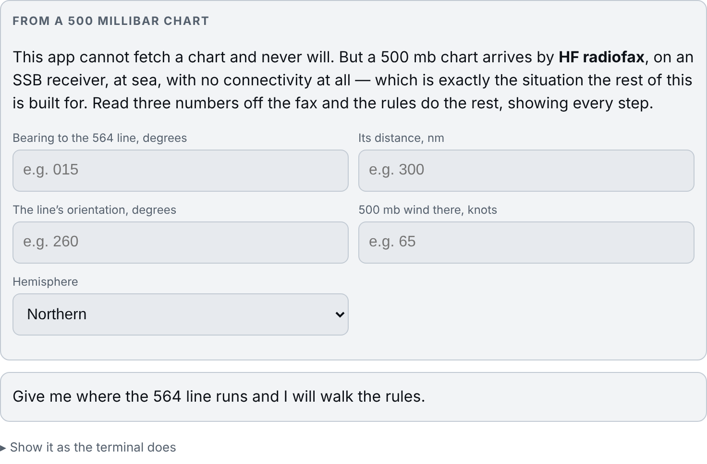
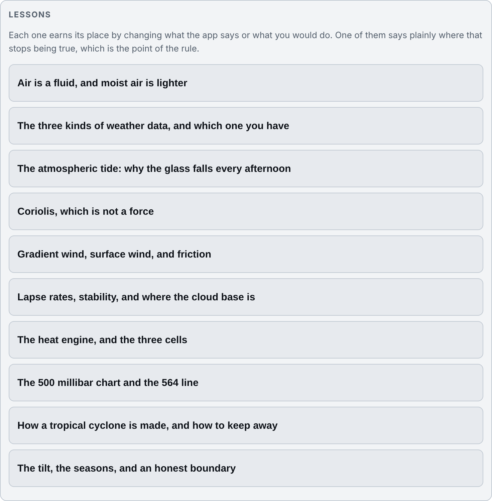

# WEATHER
## Read your own barometer

**Version {{VERSION}}** — reasoning from the observations you took, with no
network at all. It cannot forecast for you. It can make you a forecaster.

---

## 1. The honest limit, first

**With no network this cannot forecast.** No GRIBs, no synoptic charts, no
models, and there never will be any: there is no connection here to make one
with.

What it does instead is reason from the **observation** column — ground truth
you measured with your own instruments — which is the one category of weather
data that is never wrong, and the one still available when the antenna comes
down.

> Celestial navigation is what you do when the GPS dies.
> This is what you do when the sat comms die.

Everything below follows from that.

---

## 2. Where its numbers come from

It reads the log that `deck-log` writes — the same records, in the same store,
on the same device. Nothing is copied between the two tools and there is
nothing to keep in step.

**So the quality of what this tool says is the quality of your observations.**
Pressure to a tenth of a millibar, the cloud by level, the dew point, and the
swell period are what the reasoning actually uses. A log of position and
course alone gives it almost nothing to work with.

---

## 3. What the log says

`weather what` (or **What the log says**) takes your last observations and
reasons out loud. Every line is followed by the rule it came from, in smaller
type, because the point is that you can do this yourself afterwards.

### The pressure

**The rate matters more than the level.** 1000 hPa steady is a quiet day;
1015 falling fast is not. The wording follows the three-hour change:

| | |
|---|---|
| 3.0 hPa or more of fall in 3 h | *a serious fall — expect a deepening system and a rising wind* |
| 1.5 to 3.0 | *a definite fall. Something is coming* |
| within 1.5 either way | *near steady* |
| 1.5 or more of rise | *rising — the gradient is easing or a ridge is building* |

**It corrects for the atmospheric tide first.** The atmosphere has its own
semidiurnal pressure wave, largest in the tropics, and near the equator it is
big enough to hide a real trend or invent one. The correction needs your
longitude, which is why `weather lon <deg>` exists.

### The wind

**Backed or veered**, against the previous observation, with Buys Ballot
applied: stand with your back to the wind and in the northern hemisphere the
low is on your left. The tool gives the bearing of the centre from you.

**Backing with a falling glass is the one to take seriously** — it puts the
centre to your north and closing.

### Fog, and the cloud base

1. **Fog**: the margin between dew point and sea temperature. When the air's
   dew point is at or above the sea temperature, you are in the business of
   making fog.
2. **Cloud base**: the spread between temperature and dew point closes at
   about 2.5 °C per 1000 ft — a parcel cools at 3 and its dew point falls at
   0.5, and the *difference* is what counts. Using the lapse rate alone puts
   the base about a fifth too low.

### The cloud sequence

The classic warm front is cirrus, then cirrostratus, then altostratus, then
nimbostratus and rain. The tool watches your `ch` / `cm` / `cl` codes over
successive observations and tells you how far through that sequence you are —
which is a judgement you cannot make from a single observation, and the reason
the cloud is logged by level rather than as "overcast".

---

## 4. The forecast loop, and why yours comes first

**Nothing of the machine's appears until your own forecast is recorded.** If
the app prints its guess first, you have not forecast anything: you have
agreed with something. The loop is deliberate:

1. You write your forecast — wind direction and speed, pressure, and the
   weather.
2. Only then does the tool show its own two: the **rules** forecaster, and
   **persistence** (tomorrow is like today).
3. When the verifying observation arrives, all three are scored against it.

**Persistence is in there because it is the honest benchmark.** It is
surprisingly hard to beat over 12 hours, and a forecaster who cannot beat it is
not yet adding anything.

---

## 5. The score

Weighted error points, from the WxChallenge convention: half a point per knot
of wind speed, one per millibar, a tenth per degree of wind direction — so a
near miss costs little and a bad miss costs a lot.

The score exists to answer one question honestly: **are you getting better, and
are you better than persistence?**

---

## 6. The 500 millibar chart

**This tool cannot fetch a chart and never will.** But a 500 mb chart does
arrive at sea, by HF radiofax on an SSB receiver, with no internet involved at
all — and it is the one upper-air product worth having, because the 500 mb flow
is what steers the surface systems.

So `weather chart` asks for what you can read off the fax with a ruler, and
the rules do the rest, showing every step:

| | |
|---|---|
| Bearing to the **564 line** | the 5,640 m contour: the storm track runs along it |
| Its distance, in miles | |
| The line's orientation | which way it lies across your position |
| The 500 mb wind there, in knots | how fast the pattern is being steered |
| Hemisphere | which side of the line is the poleward one |

The first question it answers is whether the 564 line is **poleward of you**,
because equatorward of it is where you want to be. The rules are from
Sienkiewicz and Chesneau, *Mariner's Guide to the 500-Millibar Chart* (NOAA,
public domain), and are listed in `docs/SOURCES.md`.

---

## 7. The lessons

Each lesson changes either what the tool says or what you would do. One of them
says plainly where the reasoning stops being reliable, which is the most
important of the ten.

`weather learn` lists them; `weather learn <key>` opens one.

---

## 8. Commands

| | |
|---|---|
| `weather` | the menu |
| `weather what` | what your log says is coming, with the reasoning |
| `weather learn [key]` | a lesson; no key lists them |
| `weather chart` | reason over a 500 mb radiofax chart |
| `weather forecast` | yours first, then mine, then both are scored |
| `weather score` | how you, the rules and persistence are doing |
| `weather lon <deg>` | your longitude, east positive — for the pressure tide |
| `weather day` / `night` / `plain` | colour mode |
| `weather about` / `version` | |

It reads the deck log; `deck-log` is what writes it. It never forecasts from a
model, because there is no network here and never will be.

---

## 9. The display modes

{{INCLUDE:common-display-modes.md}}

---

## 10. Cautions

1. **This is not a forecast service.** It reasons from what you logged. It has
   no model, no satellite and no warning of anything over the horizon that has
   not announced itself in your own observations.
2. **It cannot see a system that is not yet showing.** A squall line fifty
   miles away affects nothing you have measured until it does.
3. **Garbage in.** An instrument that is out, a pressure read to the nearest
   millibar, or cloud logged as "cloudy" will give confident reasoning from bad
   input. The tool says what it is reasoning from; check that first when an
   answer surprises you.
4. **Near the equator, log your longitude.** Without it the atmospheric tide
   correction cannot be made, and the semidiurnal wave there is large enough to
   look like a trend.
5. **Where this and an official forecast differ, take the official one** and
   treat the difference as something to understand rather than to argue with.
